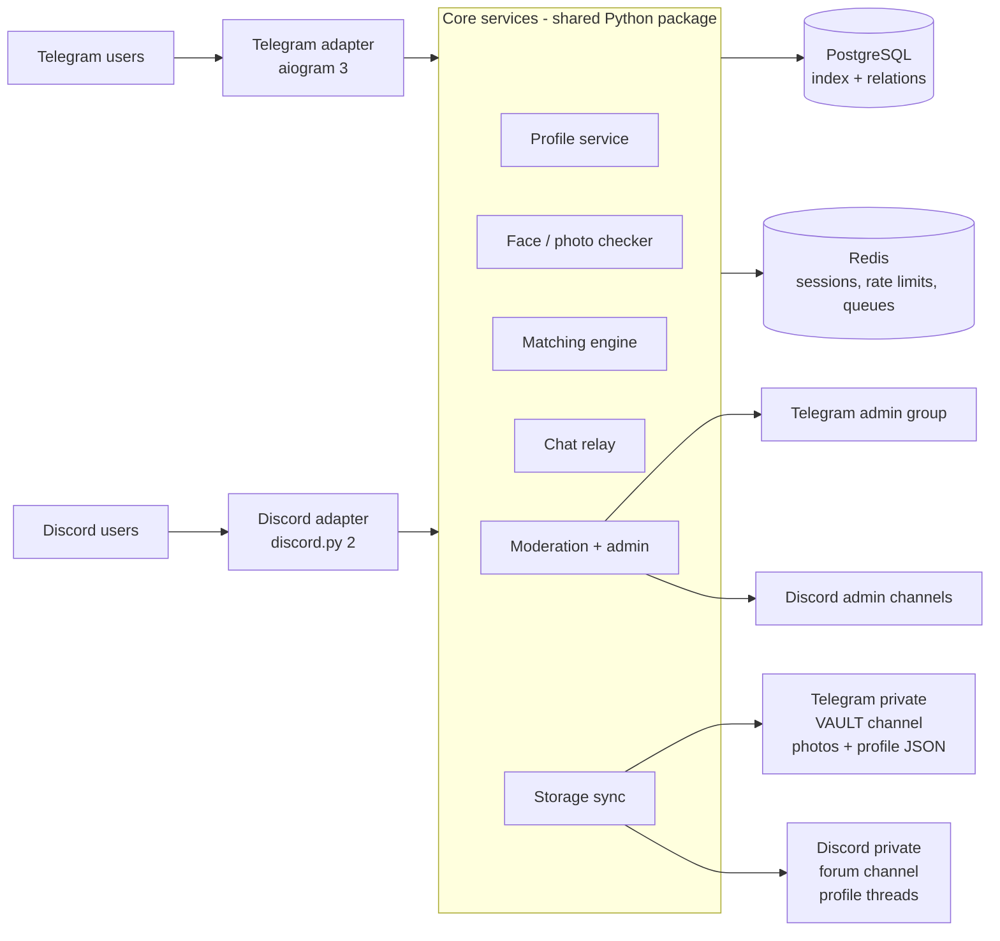

# Dating Bot — Discord + Telegram: Full Plan

> Status (2026-11-12): **phases 0–1 built**, plus the core of phase 2 (Telegram review queue with approve/reject/block-underage, audit log). See README.md. Owner/super-admin: Karan.
>
> Implementation notes vs. this plan:
> - Main-photo minimum face size is 4% of the image (8% rejected normal half-body shots); tunable via `FACE_MIN_AREA_MAIN`.
> - Duplicate/stolen photos (pHash match with another profile) are rejected outright rather than queued for review.
> - Date of birth can never be changed after it is set (it stops people retrying the 18+ gate).
> - Not built yet: language picker, prompts, voice intro, NSFW model, Alembic migrations (tables are auto-created for now).
> Name: **Amora**.

---

## 1. What we are building

One dating service, two front doors:

- **Telegram bot**: DM-based, inline-keyboard buttons, reply-keyboard main menu.
- **Discord bot**: slash commands, buttons, select menus, modals, in DMs or ephemeral messages.

Both bots share **one core**: one user pool, one matching engine, one moderation system. A Telegram user can match and chat with a Discord user through the bot relay.

### Core rules
1. **No face, no profile.** Every profile photo goes through automatic face checks. The main photo must show one clear face, and the extra photos must contain that same person.
2. **18+ only.** Date-of-birth gate, then automatic flagging and admin review of anyone who looks under 18.
3. **Admin approves every new profile** before it shows up in Browse. Auto-approve can be switched on later.
4. **You (Karan) are Owner.** You have full control from Telegram and Discord, with an audit log of every admin action.
5. **Profiles are stored on your own Telegram + Discord servers** (private channels) and indexed in a real database for fast search (see §6).

---

## 2. Architecture



**Stack**

| Part | Choice | Why |
|---|---|---|
| Language | Python 3.12 | Best face/ML libraries, and both bot libraries are mature |
| Telegram | `aiogram` 3.x | Async, FSM for step-by-step forms, inline keyboards |
| Discord | `discord.py` 2.x | Slash commands, Views (buttons/selects), Modals |
| Database | PostgreSQL 16 (SQLite for local dev) | Matching queries need filtering and sorting (see §6) |
| Cache/queue | Redis | Rate limits, browse queues, onboarding state, pub/sub between adapters |
| Face AI | OpenCV **YuNet** (detect) + **SFace** (recognize) | Small, CPU-only, and Apache/MIT licensed, so commercial use is fine. InsightFace models are **non-commercial**, so we avoid them. |
| Gestures | MediaPipe Hands (Apache 2.0) | Selfie verification: counts the fingers the user holds up |
| NSFW filter | NudeNet or open-nsfw2 (check the license before shipping) | Blocks explicit profile photos |
| Image tools | Pillow, `imagehash` | Resize, strip EXIF/GPS, perceptual hash for stolen/duplicate photos |
| Deploy | Docker Compose on a VPS | bot + postgres + redis, one `docker compose up` |

**Process layout:** one Python process that runs both bots on the same asyncio loop (simplest for MVP). The face checker runs in a `ProcessPoolExecutor` so heavy image work never freezes the bots. If load grows, split it into `tg-bot`, `dc-bot` and `worker` containers that talk over Redis.

---

## 3. Face verification system (the key feature)

Three layers, from cheap to strong.

### Layer 1: Automatic photo check (every upload)
Runs in about 200–500 ms on CPU per photo.

| Check | Rule (tunable in config) | Message the user sees if it fails |
|---|---|---|
| Face present | YuNet confidence ≥ 0.80 | "😕 We couldn't find a face. Please upload a clear photo of **you**." |
| Single face (main photo) | Exactly 1 face, or 1 face clearly dominant (≥ 2× the area of the next one) | "Main photo must show only you. Group photos can be extra photos." |
| Face size | Face box ≥ 8% of the image area | "Your face is too small. Try a closer photo." |
| Sharpness | Laplacian variance on the face crop ≥ threshold | "Photo is blurry, try another one." |
| Frontal enough | The 5 landmarks (eyes, nose, mouth corners) all inside the box, and yaw is not extreme | "Please face the camera." |
| Not explicit | NSFW score < 0.6 | "This photo isn't allowed." (strike logged) |
| Not stolen/duplicate | pHash distance > 6 from every other user's photos | Sent to admin review as a "possible stolen photo" |
| Min resolution | ≥ 400×400 | "Image too small." |

**Extra photos (2–6):** each one must contain at least one face whose SFace embedding matches the main photo (cosine similarity ≥ 0.36, the OpenCV-recommended threshold, tuned later). This stops people from using a real face for photo 1 and random pictures for the rest.

All photos are re-encoded to JPEG with **EXIF stripped**. This removes GPS location from phone photos and protects users.

### Layer 2: Selfie verification (optional but rewarded → ✅ Verified badge)
1. The user taps **✅ Get Verified**.
2. The bot shows a random challenge, for example *"Hold up ✌️ 2 fingers next to your face"* or *"Show 4 fingers"*.
3. The user sends a selfie within **3 minutes**. On Telegram we ask for camera use. A fake can't be fully blocked, but the random challenge plus the time limit defeats old photos.
4. Automatic checks:
   - Face matches the main profile photo (SFace similarity ≥ threshold)
   - MediaPipe Hands counts the right number of fingers
   - The image is new (pHash not seen before)
5. If all pass, the badge is granted automatically. Borderline results go to the **admin review queue** with the selfie and the profile photo side by side.
6. **The selfie is deleted after the decision.** We keep only `verified_at` and the method. We do not keep the face embedding of the selfie.

Browse settings can include **"Show me verified profiles only"**, which pushes people to get verified.

### Layer 3: Human review (admin queue)
Every new profile, every flagged photo and every borderline verification lands in the admin queue (§8).

### Age safety
- DOB is required, and anyone under 18 is blocked permanently. The DOB hash is stored so the person can't just retry with a different date.
- Admins see an "appears young?" checkbox in review, plus any report reason "Underage". Underage reports are **top priority**: the profile is hidden immediately, pending review.
- Automatic age estimation from faces is unreliable, so it is **not** used to auto-approve anyone. At most it adds a flag.

### Privacy of face data (important legally)
Face embeddings are **biometric data** under GDPR, Illinois BIPA and India's DPDP Act.
- Explicit consent screen before the first photo upload ("We scan your photos to check they show a real face…").
- Embeddings are stored encrypted (Fernet key from env), only for the user's own profile photos, and deleted along with the account.
- Embeddings are used only to compare a user's photos with their own other photos. There is no cross-user face search.

---

## 4. User flows and buttons

### 4.1 Onboarding (both platforms)

```
/start
 └─ 🌍 Language: [English] [हिन्दी] [Español] ...
 └─ 📜 Rules + Privacy summary
      [✅ I'm 18+ and I agree]  [📄 Read full terms]  [❌ Cancel]
 └─ 🎂 Date of birth (DD/MM/YYYY)          → under 18 = blocked
 └─ 🙋 I am:        [👨 Man] [👩 Woman] [⚧ Non-binary] [More…]
 └─ 💘 Show me:     [Men] [Women] [Everyone]
 └─ 🎯 Looking for: [💍 Relationship] [☕ Dating] [👋 Friends] [🤷 Not sure]
 └─ ✍️ Display name
 └─ 📍 Location:    [📍 Share location] (Telegram)  or  type city (both)
 └─ 📝 Bio (max 500 chars, auto-moderated: no links, phone numbers or @handles)
 └─ 🏷 Interests (pick 3–10, multi-select grid with ✅ toggles)
       [🎮 Gaming] [🎵 Music] [✈️ Travel] [🏋️ Gym] [🍳 Cooking] [📚 Books]
       [🎬 Movies] [🐶 Pets] [💻 Tech] [⚽ Sports] [🎨 Art] [➡️ More] [✔️ Done]
 └─ 💬 Prompts (optional, pick 1–3): "My ideal Sunday…", "Green flag I look for…"
 └─ 📸 Photos: send 1–6 photos → each one checked live:
       ✅ Photo 1 OK — face detected
       ❌ Photo 2 rejected — no face found
       [➕ Add more] [🔀 Reorder] [🗑 Remove] [✔️ Done]
 └─ 🎙 Voice intro (optional, Telegram voice note ≤ 30 s)
 └─ 👀 Preview card
       [✏️ Edit] [📤 Submit for review]
 └─ ⏳ "Your profile is under review, usually within a few hours."
```

Interrupted flows resume where they left off (state lives in Redis with a 24 h TTL).

### 4.2 Main menu

**Telegram** (reply keyboard, always visible):
```
[🔥 Browse]      [💌 Matches]
[👤 My Profile]  [❤️ Who Liked Me]
[⚙️ Settings]    [✅ Get Verified]
[🆘 Help & Safety]
```

**Discord:** `/dating` opens an ephemeral panel with the same buttons. Each one also exists as a slash command: `/browse`, `/matches`, `/profile`, `/likes`, `/settings`, `/verify`, `/help`.

### 4.3 Browse card
```
┌──────────────────────────────┐
│  [photo 1 of 4]   ✅ Verified│
│  Priya, 24 · 📍 5 km away    │
│  🎯 Relationship             │
│  "Coffee snob, weekend hiker"│
│  🏷 Travel · Books · Cooking  │
│  💯 82% match                 │
└──────────────────────────────┘
[◀️ Photo] [Photo ▶️]
[👎 Pass]  [❤️ Like]  [⭐ Super Like]
[💌 Like + Message]  [ℹ️ Full profile]
[🚩 Report]  [↩️ Undo]
```
- **Telegram**: one message per card, edited in place (`editMessageMedia`) when the user swipes, so the chat stays clean.
- **Discord**: Components V2 container + media gallery in DMs or an ephemeral message, edited in place.
- **Daily limits** (configurable): 50 likes/day, 1 Super Like/day, 3 Undos/day.

### 4.4 Match
Both users get:
```
🎉 It's a match with Rahul!
[💬 Start chat]  [👤 View profile]  [❌ Unmatch]
```

### 4.5 Chat relay (works across platforms)
- Messages go through the bot, so **real usernames stay hidden** until both agree.
- Supports text, emoji and stickers (Telegram ↔ Telegram). Photos are allowed only after both tap **"Allow photos"**, and every photo is NSFW-scanned.
- On Telegram, a chat session is "active". Plain messages go to the current match, and `💬 Switch chat` picks another one.
- On Discord, a private DM thread per match, or a `/reply` command.
- Chat buttons:
```
[🔓 Reveal my username] [🖼 Allow photos]
[🚫 Block] [🚩 Report] [❌ Unmatch]
```
- **🔓 Reveal**: when both tap it, each side receives the other's @username or Discord tag.
- **Anti-scam filter** for the first 20 messages: links, phone numbers, crypto addresses and "add me on…" are blocked or soft-warned.
- Message retention: deleted 90 days after unmatch (configurable). Admins can read a conversation **only when it was reported** (stated in the privacy policy).

### 4.6 My Profile
```
[✏️ Edit bio] [📸 Manage photos] [🏷 Interests] [💬 Prompts]
[🎯 Looking for] [📍 Location] [👁 Preview as others see me]
[⏸ Pause profile] [🔗 Link Discord/Telegram] [🗑 Delete account]
```
Editing photos re-runs the face checks. A changed main photo removes the Verified badge until the user verifies again.

### 4.7 Settings
```
Age range:     [18–25] [25–35] [35–45] [Custom]
Distance:      [5 km] [25 km] [100 km] [Anywhere]
Show me:       [Men] [Women] [Everyone]
Verified only: [On/Off]
Notifications: [New match ✅] [New message ✅] [Who liked me ✅]
Incognito:     [On/Off]  (only people you liked see you)
Language:      [...]
Data:          [📦 Export my data] [🗑 Delete everything]
```

### 4.8 Account linking (one profile on both platforms)
`/link` gives a 6-digit code, valid for 10 minutes. Entering it in the other platform's bot merges both into one account: the same profile, matches and chats, reachable from both.

---

## 5. Matching engine

**Candidate filter (SQL):** active + approved + not banned + not paused, mutual "show me" gender preference, both age ranges satisfied, within distance (geohash or PostGIS), not already swiped, not blocked by either side.

**Ranking score (0–100, shown as "💯 82% match"):**
| Factor | Weight |
|---|---|
| Interest overlap (Jaccard) | 30 |
| Same "looking for" | 20 |
| Distance (closer is higher) | 15 |
| Recently active | 15 |
| Verified | 10 |
| Profile completeness (photos, prompts, bio) | 10 |

**Fairness:** a profile's exposure is capped so the same few people don't get shown to everyone. New profiles get a 48 h "new here" boost.

**Queue:** each user has a pre-computed queue of 30 candidates in Redis, refilled in the background, so Browse is instant.

**Daily picks (advanced):** 5 best-score suggestions every evening, sent as a notification.

---

## 6. Storage: "our Telegram and Discord servers as database"

You asked for profiles to be stored on your Telegram and Discord servers. That's doable, with one caveat that shapes the design:

> **Telegram and Discord channels can't be queried.** You can't ask a Discord channel for "women 22–28 within 10 km who like hiking." With 10,000 profiles, the bot would have to read every message, and both platforms rate-limit that heavily. Discord image links also **expire after about 24 h** (signed CDN URLs), so they can't be used as permanent photo links.

**So the design is a hybrid, giving you both:**

| Layer | Holds | Role |
|---|---|---|
| **Telegram VAULT channel** (private, only the bot + you) | Every photo (we keep Telegram's `file_id`, which is permanent and free for the same bot) + a **JSON snapshot of each profile** as a document, edited on every update | **Permanent master copy and backup.** The whole database can be rebuilt from here with `/admin rebuild`. |
| **Discord PROFILES forum channel** (private, admins only) | One forum post per user: profile card embed + photos + tags (`pending`, `approved`, `verified`, `banned`) | **Human-friendly archive.** You can scroll, search by name and see each profile's status. Admin buttons sit on every post. |
| **PostgreSQL** | Profile fields, swipes, matches, chats, reports, plus the message IDs that point to the vault/forum copies | **Fast index** for matching, search and stats. Small, and fully rebuildable from the Telegram vault. |

So the profiles **really do live on your Telegram and Discord servers**, and the database works as a search index on top of them.

**Photo delivery:**
- To Telegram users: send by `file_id`, which is instant and needs no re-upload.
- To Discord users: the bot downloads from Telegram by `file_id` once, caches it on local disk / S3-compatible storage for 7 days, and attaches it.

**Sync rules:**
- Every profile change writes the DB → Telegram vault → Discord forum, in that order. Retries with backoff go through a Redis queue.
- Deleting an account deletes it everywhere: DB rows, vault messages and forum post (GDPR / "right to be forgotten").
- A nightly job checks that the DB and vault agree and reports any drift to the admin log.

**Backups:** a nightly `pg_dump`, encrypted and sent to the vault channel as a file. Keeps 14 days.

---

## 7. Database schema (PostgreSQL)

```sql
users            (id PK, created_at, status[onboarding|pending|active|paused|banned|deleted],
                  role[user|mod|admin|owner], dob, dob_hash, gender, show_me[], looking_for,
                  display_name, bio, city, lat, lon, geohash, lang, is_verified, verified_at,
                  premium_until, last_active_at, strikes)
platform_accounts(id PK, user_id FK, platform[telegram|discord], platform_user_id UNIQUE,
                  username, dm_channel_id, linked_at)
photos           (id PK, user_id FK, position, tg_file_id, tg_vault_msg_id, dc_forum_msg_id,
                  phash, face_embedding BYTEA(encrypted), face_score, nsfw_score,
                  status[ok|pending|rejected], created_at)
interests        (id PK, slug, emoji, label)          user_interests(user_id, interest_id)
prompts          (user_id, prompt_key, answer)
swipes           (from_user, to_user, action[like|pass|superlike], message, created_at, PK(from,to))
matches          (id PK, user_a, user_b, created_at, unmatched_by, unmatched_at,
                  photos_allowed_a, photos_allowed_b, revealed_a, revealed_b)
messages         (id PK, match_id FK, sender_id, kind[text|photo|sticker|voice], body,
                  tg_file_id, flagged, created_at)          -- purged by retention job
blocks           (blocker, blocked, created_at)
reports          (id PK, reporter, reported, match_id NULL, reason, details, evidence_msg_ids,
                  status[open|actioned|dismissed], handled_by, handled_at, priority)
verifications    (id PK, user_id, challenge, result[pass|fail|review], score, reviewed_by, created_at)
bans             (id PK, user_id, reason, banned_by, until NULL=permanent, created_at)
admin_actions    (id PK, admin_id, action, target_user, details JSONB, created_at)  -- audit log
storage_sync     (user_id, tg_vault_msg_id, dc_forum_thread_id, last_synced_at, hash)
settings_kv      (key PK, value JSONB)   -- runtime config editable from the admin panel
```

---

## 8. Admin system (your access)

### Roles
| Role | Who | Can |
|---|---|---|
| **Owner** | You. Telegram ID + Discord ID set in `.env` (`OWNER_TG_IDS`, `OWNER_DC_IDS`), so nobody can remove you | Everything, including adding/removing admins, bot settings and data export |
| **Admin** | Added by the Owner via `/admin add` | Review, ban, verify, broadcast, stats |
| **Moderator** | Added by Owner/Admin | Review queue + reports only |

Owner IDs come from the env file, not the database, so a database problem can't lock you out.

### Where admins work
- **Telegram:** a private admin group (bot is admin) with topics: `📋 Review`, `🚩 Reports`, `✅ Verifications`, `🧾 Logs`. Also `/admin` in DM with the bot.
- **Discord:** a private category: `#review-queue`, `#reports`, `#verifications`, `#admin-log` + the `PROFILES` forum. Only the "Dating Admin" role can see it.

Both stay in sync: when one admin approves on Discord, the Telegram copy of the card updates to "✅ Approved by X" so two admins never handle the same item.

### Admin panel (`/admin`)
```
🛠 Admin Panel                    👑 Owner
[📋 Review queue (12)]  [🚩 Reports (3)]
[✅ Verifications (5)]  [🔍 Find user]
[📊 Stats]              [📣 Broadcast]
[🚫 Bans]               [👥 Manage admins]
[⚙️ Bot settings]       [🧾 Audit log]
[💾 Backup now]         [♻️ Rebuild DB from vault]
```

### Review card (new profile)
```
🆕 New profile #1042 · Telegram · @username
Priya, 24 · Woman → Men · Mumbai
Bio: ...
📸 4 photos · face ✅✅✅✅ · NSFW ok · duplicates: none
⚠️ Flags: none
[✅ Approve] [❌ Reject ▾] [📸 Ask for new photo] [🔍 Full details] [🚫 Ban]
```
The Reject dropdown offers: No clear face · Fake/stolen photo · Looks underage · Inappropriate · Spam/scam · Other (modal for text). The user gets a polite message with the reason and an **[✏️ Fix profile]** button.

### Report card
```
🚩 Report #88 · priority HIGH · reason: Scam
Reporter: #2001  →  Reported: #1042 (3 previous reports)
Evidence: last 20 messages of the conversation (attached)
[⚠️ Warn] [⏸ Suspend 7d] [🚫 Ban] [👻 Shadow-ban] [✅ Dismiss] [👤 Open profile]
```

### Find user → user control card
Search by ID, @username, Discord tag or name, and get:
```
[✏️ Edit profile] [🖼 Remove photo] [✅ Give/remove Verified] [⭐ Give Premium]
[⏸ Suspend] [🚫 Ban (both platforms)] [♻️ Unban] [🗑 Delete account]
[💬 Message user] [📜 History (reports, actions)]
```
Bans apply to the **person**, not the platform account: banning a linked user bans them on both. The banned user's platform IDs plus photo pHashes go on a blocklist, so they can't come back with the same face photos.

### Stats
Total users, by platform, by gender, new today/7d, DAU/WAU, pending reviews, verification rate, matches/day, messages/day, reports/day, top cities. Includes a `📈 Chart` button that renders a PNG chart.

### Broadcast
Target: all / Telegram only / Discord only / segment (city, gender, inactive 7d). Preview first, then **[Send] [Cancel]**. Throttled to platform limits, and users can turn broadcasts off.

### Bot settings (runtime, no restart)
Auto-approve on/off · face-match threshold · daily like limit · new registrations open/closed · maintenance mode · banned words list · minimum photos.

Every admin action is written to `admin_actions` and posted to the log channels.

---

## 9. Safety, trust and legal

- **Report everywhere:** on cards, in chats, on profiles. Reasons: Fake / Underage / Harassment / Scam / Inappropriate photos / Other.
- **Auto-actions:** 3 unique reports in 24 h auto-hide the profile until review. An "Underage" report hides it immediately.
- **Rate limits:** per-user button and message limits. New accounts (< 24 h) get lower limits.
- **Scam and spam detection:** link/phone/crypto filters, repeated-message detection, and too many likes in a short time trigger a shadow-ban for review.
- **Block** is instant and mutual-invisible.
- **Safety tips** in `🆘 Help & Safety`: meet in public, don't send money, report scams.
- **Legal docs needed before launch:** Terms of Service, Privacy Policy (biometric consent, data retention, admin access to reported chats), Community Guidelines. Use a lawyer for the market you launch in.
- **Platform rules:** Telegram and Discord both forbid minors in dating and sexual content involving minors. Discord in particular bans teen dating. Keep the Discord server **age-restricted (18+)**, keep profiles SFW, and re-check Discord's Community Guidelines and Developer Policy before launch.
- **Secrets:** bot tokens, DB password and the Fernet key live only in `.env`, which is never committed.

---

## 10. Advanced and monetization features (later phases)

| Feature | Notes |
|---|---|
| ⭐ Premium | Unlimited likes, see who liked you, 5 Super Likes/day, Undo, Incognito, 1 Boost/week. Telegram: **Telegram Stars** (required for digital goods in Telegram bots). Discord: **Discord App Subscriptions / Premium SKUs**. |
| 🚀 Boost | 30 min at the top of the queue in your area |
| 🎙 Voice intro | Telegram voice note on the profile card |
| 🧊 Icebreakers | Bot suggests an opening line from shared interests |
| 🌐 Auto-translate chat | For cross-language matches (LLM or translation API) |
| 🤖 AI bio helper | "Help me write my bio" button |
| 🗓 Events | Speed-dating nights in a Discord voice channel / Telegram group |
| 🌍 Web admin dashboard | Later; the same API as the bot admin panel |

---

## 11. Project structure

```
DATING/
├── docker-compose.yml        # bot, postgres, redis
├── .env.example              # tokens, OWNER ids, channel ids, keys
├── pyproject.toml
├── docs/PLAN.md              # this file
├── migrations/               # alembic
├── models/                   # ONNX: yunet.onnx, sface.onnx (downloaded by script)
└── amora/
    ├── main.py               # starts both bots on one loop
    ├── config.py
    ├── core/
    │   ├── profiles.py       # create/update/delete, validation
    │   ├── photos.py         # face checks, NSFW, pHash, EXIF strip
    │   ├── verification.py   # selfie challenge
    │   ├── matching.py       # filter + score + queues
    │   ├── chat.py           # relay, filters, reveal, retention
    │   ├── moderation.py     # reports, bans, auto-actions
    │   ├── admin.py          # roles, audit log, stats, broadcast
    │   └── storage_sync.py   # Telegram vault + Discord forum mirror, rebuild
    ├── db/                   # SQLAlchemy models + repositories
    ├── adapters/
    │   ├── telegram/         # aiogram routers, keyboards, FSM states
    │   └── discord/          # cogs, Views, Modals, slash commands
    ├── i18n/                 # en.json, hi.json, ...
    └── tests/
```

The **core never imports aiogram or discord.py**. Adapters translate button presses into core calls and core results into platform messages. That's what makes the cross-platform features work.

---

## 12. Build phases

| Phase | Deliverable | Est. |
|---|---|---|
| **0. Setup** | Repo, Docker Compose, config, DB migrations, both bots online with `/start` | 1–2 days |
| **1. Profiles + face check** | Full onboarding on Telegram, face/NSFW/pHash pipeline, Telegram vault storage | 4–5 days |
| **2. Admin core** | Owner/admin roles, review queue with buttons (Telegram), approve/reject, audit log | 2–3 days |
| **3. Discord parity** | Onboarding via slash commands + modals, Discord forum mirror, Discord admin channels | 4–5 days |
| **4. Browse + match** | Matching engine, browse cards, likes/passes, match notifications, limits | 3–4 days |
| **5. Chat relay** | Cross-platform chat, reveal, photo consent, anti-scam filters, block/report | 3–4 days |
| **6. Verification + safety** | Selfie gesture verification, reports workflow, bans across platforms, auto-actions | 3 days |
| **7. Polish** | Settings, account linking, stats, broadcast, i18n, data export/delete, backups, rebuild-from-vault | 3–4 days |
| **8. Launch prep** | Legal docs, load test, security review, VPS deploy | 2–3 days |
| **9+. Advanced** | Premium (Stars / Discord SKUs), boosts, daily picks, AI helpers | later |

**MVP = phases 0–6** (about 4 weeks of focused work).

---

## 13. What I need from you before building

1. **Bot name** (instead of "Amora") and the languages to support first.
2. **Bot tokens**: create via @BotFather (Telegram) and the Discord Developer Portal. Don't paste them in chat; put them in `.env`.
3. **Your Telegram user ID and Discord user ID** (for Owner access).
4. **Telegram**: create a private channel (vault) + a private group with topics (admin), and add the bot as admin to both.
5. **Discord**: a server with an 18+ age-restricted setup, an admin category + forum channel, and the bot invited with the needed permissions.
6. **Target country/region**, which decides the legal requirements and the default language.
7. **Should Discord browsing happen in DMs only, or also in a server channel** (ephemeral)?
8. **Free at launch, or premium from day 1?**
